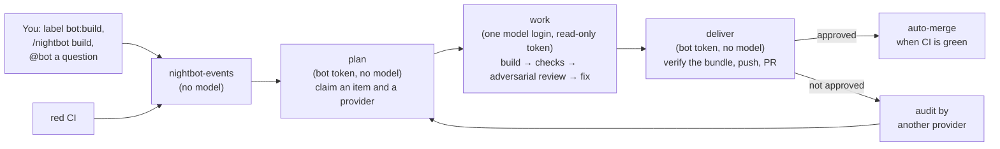

# Night Bot Scaffolding

A night bot you can copy into any GitHub repository: label an issue, and while you sleep an AI
coding CLI builds it on a branch, your checks run, a fresh session of the model reviews the change
adversarially and the model fixes what it finds, and a pull request opens that merges itself once
the review approves and CI passes. It answers questions about the code, too, on the cheapest model
that is free.

It is a generalized version of a night bot that has run a production game repository through
thousands of pull requests: the same security split, the same review loop, with everything
specific to that project taken out.

- **Any model CLI.** Claude Code, OpenAI Codex and Google's Gemini CLI built in; anything else with
  a few lines of JSON ([providers](template/.nightbot/docs/providers.md)).
- **Weak, medium and strong models.** Questions and triage go to weak models first, medium items
  to the cheapest model that can build them, hard items only to strong ones.
- **Every subscription you have.** Each with its own hours, lanes, minute caps and login; a
  subscription refused for usage limits is parked until its reset while the work moves on.
- **Runs on GitHub's runners, or on your own machine** on AWS, Azure, Google Cloud or a computer
  you own, which wakes when work waits and powers off when idle
  ([machines](template/.nightbot/machine/README.md)).
- **The model never holds a GitHub write token**, and the bot cannot change its own rules
  ([security](template/.nightbot/docs/security.md)).
- **Merge queues.** Approved changes join the queue pinned to the reviewed commit; one the queue
  throws out comes back with the newest `main` merged in and the failure fixed, and one that
  conflicts with `main` gets the merge by itself ([merge queue](template/.nightbot/README.md#the-merge-queue)).
- **One Go binary, standard library only**, built and cached by the workflows; no service to host.

## How it works



[`template/.nightbot/docs/architecture.md`](template/.nightbot/docs/architecture.md) walks through
a run step by step.

## Quick start

You need: a GitHub repository with a CI workflow, admin access to it, Go 1.24+ and `gh` on your
computer, and at least one model subscription (a Claude Pro or Max plan is enough to start).

1. **Install it into your repository:**

   ```bash
   git clone https://github.com/Jlore-Studios/Night-Bot-Scaffolding.git
   ./Night-Bot-Scaffolding/install.sh path/to/your-repo --bot-login your-bot --operator your-login --ci-workflow CI
   ```

   `--ci-workflow` is the `name:` of your CI workflow. Add `--merge-queue` to merge through a
   merge queue (your CI must then run on `merge_group`). This copies `.nightbot/` (the harness,
   its configuration, prompts, docs and machine scripts) and three workflows into your repository.

2. **Give the bot a GitHub identity.** Pushes and pull requests made with a workflow's own
   `GITHUB_TOKEN` start no CI, so the bot needs its own:
   - **A GitHub App** (recommended): create one with Contents, Issues and Pull requests read and
     write and Actions read, install it on the repository, and set the repository variable
     `NIGHTBOT_APP_ID` and the secret `NIGHTBOT_APP_PRIVATE_KEY`. Then `--bot-login` is
     `<app-slug>[bot]`.
   - **Or a bot account**: a second GitHub account with write access, and a classic token with the
     `repo` scope as the secret `NIGHTBOT_GITHUB_TOKEN`.

3. **Add a model login.** For Claude: run `claude setup-token` and save what it prints as the
   repository secret `CLAUDE_CODE_OAUTH_TOKEN`. Enable or add providers in
   `.nightbot/providers.json`; each `login: secret` provider's secret must be listed in both
   workflows' `NIGHTBOT_SECRETS_SET` blocks (`nightbot validate` tells you).

4. **Tell it how to check a change.** In `.nightbot/config.json`, set `checks` to the commands that
   prove a change works (`npm test`, `pytest`, `go test ./...`) and `required_checks` to the CI
   checks your default branch must pass. If the checks need a toolchain, add its setup steps at the
   marked spot in `.github/workflows/nightbot-run.yml`.

5. **Commit, push, and set the repository up once** (labels, the state branch, auto-merge and
   branch protection), with an admin token:

   ```bash
   cd path/to/your-repo/.nightbot/harness
   go run ./cmd/nightbot validate
   GITHUB_TOKEN=$(gh auth token) go run ./cmd/nightbot setup --repo-settings
   ```

6. **Try it.** Open an issue, comment `/nightbot build --force`, and watch the `nightbot-run`
   workflow in the Actions tab. A manual run of `nightbot-run` takes `dry_run`, which records every
   GitHub write instead of making it. The **Night bot status** issue shows what runs, the
   providers and the queue.

[`template/.nightbot/README.md`](template/.nightbot/README.md), which is installed as
`.nightbot/README.md`, is the operating guide: the commands, labels, off switches and what to do
when something goes wrong.

## Where the models run

| Where | When | Set up with |
|---|---|---|
| GitHub's hosted runners | a login that travels as a secret (Claude, API keys); free on public repositories | nothing: the default `runs_on: ubuntu-latest` |
| AWS EC2 | a login that must stay on a machine (a ChatGPT plan through Codex, a Google sign-in), long toolchain installs, more control | `.nightbot/machine/aws/`: provision, a Lambda that starts the box when a job waits, an idle stop, a budget alert |
| Azure VM | the same, on Azure | `.nightbot/machine/azure/`: provision, an Azure Function starter, an idle *deallocate*, a budget alert |
| Google Cloud VM | the same, on Google Cloud | `.nightbot/machine/gcp/`: provision, a Cloud Run function starter, an idle stop, a budget alert |
| A computer you own | a home server or spare PC, or a model on your own hardware | `.nightbot/machine/local/` |

On a machine, every provider is a Linux user of its own with its own runner, so a login is never
readable by another provider's jobs. [`template/.nightbot/machine/README.md`](template/.nightbot/machine/README.md)
has the build guides.

## Weak queries, medium and hard work

| Work | Tier | Example models |
|---|---|---|
| answering a question, triaging an unrated issue | weak (cheapest first) | Haiku, Gemini Flash |
| building and reviewing a `difficulty:medium` item | medium or better, weakest first | Sonnet, Gemini Pro, GPT-5 Codex |
| building and reviewing a `difficulty:hard` item | strong only | Opus |

A provider lists its models with their tiers, and every run takes the weakest model that is strong
enough for the work, on the free provider whose fitting model is cheapest.

## This repository

| Path | What |
|---|---|
| `install.sh` | copies `template/` into your repository and fills in its config (`--upgrade` replaces only the harness later) |
| `template/.nightbot/harness/` | the harness: Go, standard library only, with its tests |
| `template/.nightbot/{config,providers}.json`, `trust.txt`, `prompts/` | the configuration and prompts your copy starts from |
| `template/.nightbot/docs/` | architecture, configuration, providers and security |
| `template/.nightbot/machine/` | self-hosted runners on AWS, Azure, Google Cloud or your own machine |
| `template/.github/` | the events, run and selftest workflows and the action that builds the harness |
| `.github/workflows/ci.yml` | this repository's own CI |

## Developing it

```bash
cd template/.nightbot/harness
gofmt -l . && go vet ./... && go test -race ./...
cd ../machine/starter && python3 -m unittest -v
shellcheck -x ../*/*.sh
```

This repository protects its own `main` the same way: CI's four jobs required, and a merge queue
(`.github/ruleset-main.json`). An admin applies it once:

```bash
gh api -X POST repos/Jlore-Studios/Night-Bot-Scaffolding/rulesets --input .github/ruleset-main.json
```

The harness's end-to-end tests run whole runs (plan, a scripted stand-in for a model CLI working
in a real git repository, deliver) against an in-memory GitHub: building, the review loop, audits,
CI fixes, questions on the weak model, triage, refusals parking a provider, forbidden paths and the
off switches.

## License

MIT: see [LICENSE](LICENSE).
